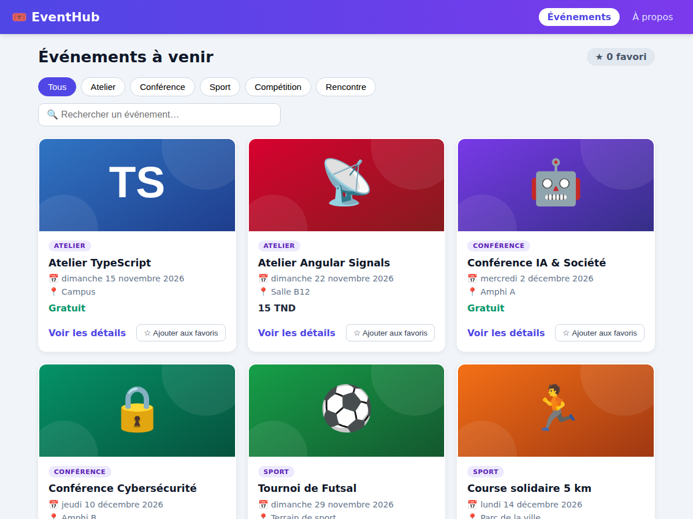
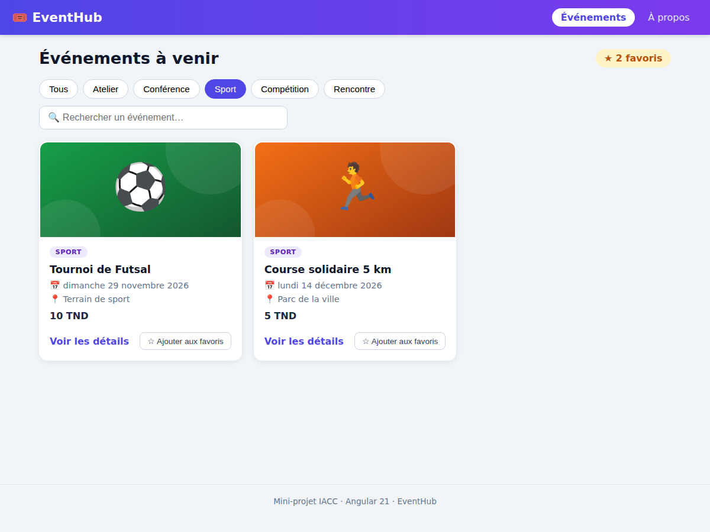
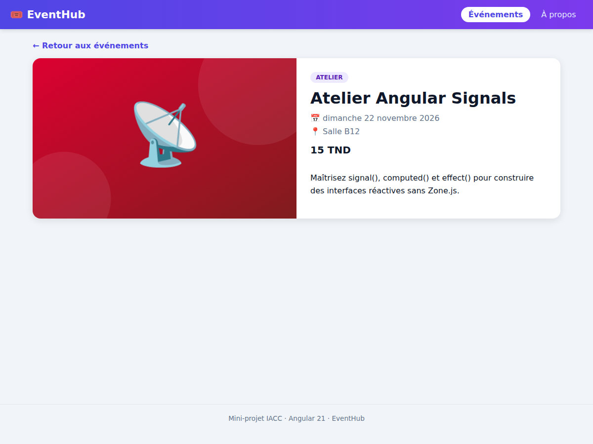
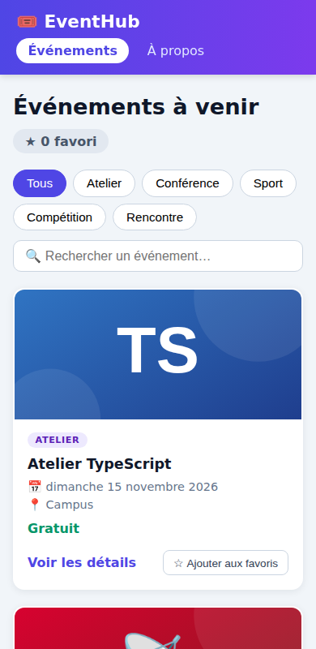

# EventHub – Catalogue d'événements

Mini-projet **Angular 21** (architecture standalone). Application 100 % côté client permettant de consulter les événements d'une association étudiante, d'afficher leurs détails, de filtrer la liste et de gérer une sélection de favoris. Les données sont définies dans le code TypeScript : aucune API, base de données ni authentification.

## Versions utilisées

| Outil | Version |
|---|---|
| Angular | 21.2.25 |
| TypeScript | 5.9.3 |
| Node.js | v22.22.2 |
| npm | 10.9.7 |

## Installation et lancement

```bash
git clone URL_DU_DEPOT
cd eventhub-votre-nom
npm install
ng serve        # puis ouvrir http://localhost:4200
```

Autres commandes : `ng build` (build de production), `ng test` (tests unitaires Vitest).

## Structure des composants

```
src/app/
├── components/
│   ├── header/        Header
│   └── event-card/    EventCard
├── pages/
│   ├── event-list/    EventList
│   ├── event-details/ EventDetails
│   ├── not-found/     NotFound
│   └── about/         About (lazy loading)
├── data/events.data.ts   Jeu de données (8 événements)
├── models/event.model.ts Interface EventItem
├── app.routes.ts         Routes
└── app.config.ts         provideRouter + withComponentInputBinding
```

| Composant | Rôle |
|---|---|
| **Header** | Affiche le titre de l'application et le menu de navigation (`routerLink` + `routerLinkActive` pour la page active). |
| **EventList** | Page principale : stocke les événements et les favoris dans des Signals, applique le filtre de catégorie et la recherche, affiche les cartes avec `@for` / `@empty`. |
| **EventCard** | Carte d'un événement : reçoit l'événement via `input()`, affiche ses infos (pipes `date`, `currency`, `uppercase`) et signale le clic « favori » au parent via `output()`. |
| **EventDetails** | Page de détail : récupère l'identifiant de la route (`input()` + `withComponentInputBinding()`) et affiche l'événement, ou un message si l'identifiant n'existe pas. |
| **NotFound** | Page 404 affichée pour toute URL inconnue (route `**`). |
| **About** | Page de présentation, chargée en lazy loading avec `loadComponent()`. |

## Fonctionnalités réalisées

- 8 événements (5 catégories, 3 gratuits) définis en TypeScript et stockés dans un **Signal**
- Liste avec `@for (...; track event.id)` et message `@empty` : « Aucun événement disponible »
- **Favoris** : bouton ajouter/retirer (`output()` → `update()` dans le parent), compteur calculé avec `computed()`, état visuel avec `@if/@else` et `[class.active]`
- **Filtre de catégorie** (Signal) + recherche par titre
- **Routage** : `/events`, `/events/:id`, `/about`, `**`, redirection de l'URL vide vers `/events`
- Lien actif dans le menu (`routerLinkActive`), lien « Voir les détails » avec `[routerLink]`
- **Lazy loading** de la page About (`loadComponent()`) : un chunk JS séparé est téléchargé à la première visite de `/about` (visible dans l'onglet *Network*)
- Interface **responsive** (grille adaptative, menu et filtres qui passent à la ligne sur mobile)
- Locale française pour les dates et les prix (`LOCALE_ID`)

## Tests manuels effectués

| Cas | Résultat |
|---|---|
| Affichage initial | 8 cartes, compteur « 0 favori » ✅ |
| Filtre de catégorie | « Sport » → 2 cartes ✅ |
| Liste vide | Recherche sans résultat → « Aucun événement disponible » ✅ |
| Ajout / retrait de favori | Compteur et bouton mis à jour ✅ |
| Navigation vers un détail | `/events/2` affiche le bon événement ✅ |
| Identifiant inexistant | `/events/999` → message « Événement introuvable » ✅ |
| Lien actif | « Événements » mis en évidence (y compris sur un détail) ✅ |
| URL inconnue | Page 404 ✅ |
| Chargement de `/about` | Chunk JS chargé à la première navigation ✅ |
| URL vide | Redirigée vers `/events` ✅ |

Des tests unitaires (`ng test`) couvrent aussi l'affichage, le filtre, l'état vide et les favoris.

## Captures d'écran

| Liste | Filtre + favoris |
|---|---|
|  |  |

| Détail | Mobile |
|---|---|
|  |  |
